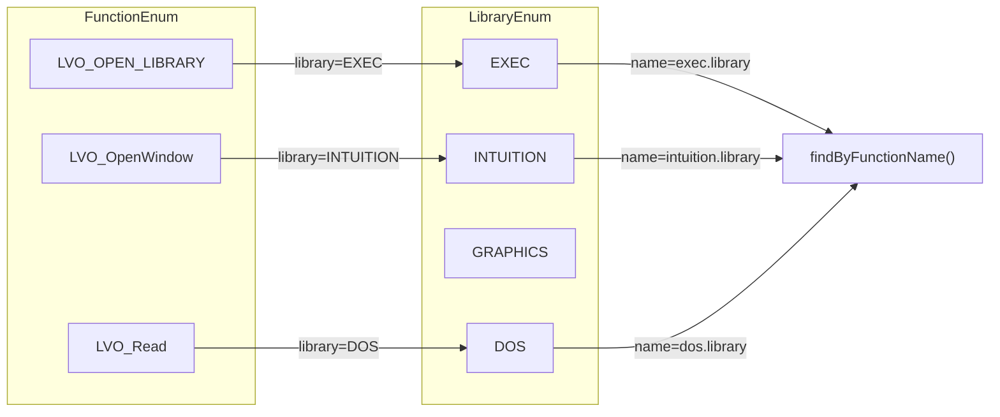
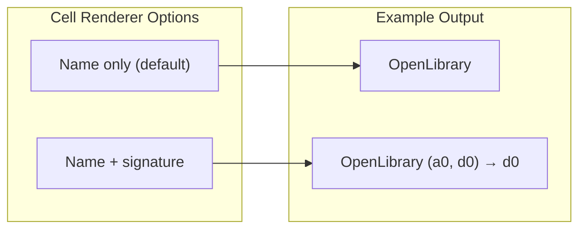

# Requirements

### Overview & Purpose

Add an **Amiga Library Reference** feature to the M68k plugin. The feature provides documentation for all standard Amiga Kickstart library functions (exec, dos, graphics, intuition, etc.) across all Kickstart versions. Users can browse library functions in a new M68k Browser pane and get editor documentation popups for `_LVOFunctionName(a6)` patterns.

### User Stories

- As an Amiga assembler developer, I want to browse all library functions available in a selected library version so that I can discover available API calls.
- As an Amiga assembler developer, I want to see function documentation (LVO offset, input/output registers, description) when I hover over `_LVOFunctionName` in my code.
- As an Amiga assembler developer, I want to filter library functions by library version so that I only see functions available in my target environment.

### Scope

**In Scope:**
- Cover all standard Kickstart libraries (see Library Classification table below for complete list)
- Cover Kickstart versions: 1.0, 1.1, 1.2, 1.3, 2.0, 2.04, 2.1, 3.0, 3.1
- Support custom library versions for third-party libraries (e.g., Picasso96 V46.0, CyberGfx 4.32)

### Library Classification

The following table classifies all Amiga libraries by category, Kickstart version introduced, function count, and available documentation resources.

#### Core Libraries (Kickstart 1.0–1.3)

These libraries are present in all Kickstart versions and have extensive documentation.

| Library | Purpose | KS Version | Functions | VBCC Inline | antek LVO | wiki.amigaos.net |
|---|---|---|---|---|---|---|
| exec.library | Process and memory management | 1.0 | ~80 | ✓ | ✓ | ✓ |
| dos.library | Disk, file and folder management | 1.0 | ~90 | ✓ | ✓ | ✓ |
| graphics.library | Graphics, sprites/bobs, pixel graphics | 1.0 | ~110 | ✓ | ✓ | ✓ |
| intuition.library | Screens, windows and gadgets | 1.0 | ~100 | ✓ | ✓ | ✓ |
| diskfont.library | Bitmap/compugraphic font management | 1.0 | ~15 | ✓ | ✓ | ✓ |
| expansion.library | Device expansion library | 1.0 | ~10 | ✓ | ✓ | ✓ |
| keymap.library | Keyboard mapping processing | 1.0 | ~8 | ✓ | ✓ | ✓ |
| translator.library | Speech translator functions | 1.0 | ~10 | ✓ | ✓ | ✓ |
| mathffp.library | Math floating point processing | 1.0 | ~15 | ✓ | ✓ | ✓ |
| mathieeesingtrans.library | Math IEEE single precision functions | 1.0 | ~20 | ✓ | ✓ | ✓ |
| mathieeedoubbas.library | Math IEEE double precision base | 1.0 | ~10 | ✓ | ✓ | ✓ |
| mathieeedoubtrans.library | Math IEEE double precision trig | 1.0 | ~15 | ✓ | ✓ | ✓ |
| mathtrans.library | Math single precision processing | 1.0 | ~10 | ✓ | ✓ | ✓ |
| icon.library | Workbench icon management | 1.3 | ~10 | ✓ | ✓ | ✓ |
| layers.library | Graphic layer management | 1.3 | ~30 | ✓ | ✓ | ✓ |
| wbarchive.library | Workbench archive (icon data) | 1.3 | ~8 | ✓ | ✓ | ✓ |
| utility.library | Miscellaneous utility functions | 1.3 | ~15 | ✓ | ✓ | ✓ |
| battclock.resource | Battery-backed clock access | 1.0 | 3 | ✓ | ✓ | ✓ |
| timer.device | Timer functions | 1.0 | ~12 | ✓ | ✓ | ✓ |
| console.device | Console I/O | 1.0 | ~8 | ✓ | ✓ | ✓ |
| disk.device | Floppy disk access | 1.0 | ~10 | ✓ | ✓ | ✓ |
| serial.device | Serial port access | 1.0 | ~10 | ✓ | ✓ | ✓ |
| parallel.device | Parallel port access | 1.0 | ~8 | ✓ | ✓ | ✓ |
| custom.chip | Custom chip registers | 1.0 | N/A | N/A | N/A | ✓ |

#### Standard Libraries (Kickstart 2.0+)

These libraries were added in Kickstart 2.0 and later. They have good documentation coverage.

| Library | Purpose | KS Version | Functions | VBCC Inline | antek LVO | wiki.amigaos.net |
|---|---|---|---|---|---|---|
| gadtools.library | Gadgets and menus helper | 2.0 | ~15 | ✓ | ✓ | ✓ |
| asl.library | Application Support Library (dialogs) | 3.0 | ~6 | ✓ | ✓ | ✓ |
| datatypes.library | File and data type processing | 3.0 | ~20 | ✓ | ✓ | ✓ |
| iffparse.library | IFF file parsing functions | 2.0 | ~15 | ✓ | ✓ | ✓ |
| locale.library | Internationalization support | 3.0 | ~25 | ✓ | ✓ | ✓ |
| reboot.library | System reboot functions | 3.0 | ~5 | ✓ | ✓ | Partial |
| requester.library | System requester functions | 3.0 | ~8 | ✓ | ✓ | Partial |
| speedbar.library | Speedbar (taskbar) functions | 3.1 | ~5 | ✓ | ✓ | Partial |
| application.library | Application management | 3.1 | ~15 | ✓ | ✓ | Partial |
| realtime.library | Realtime clock processing | 3.1 | ~10 | ✓ | ✓ | Partial |
| specialfx.library | Workbench special effects | 3.1 | ~6 | ✓ | ✓ | Partial |
| commodities.library | Background commodity functions | 2.0 | ~10 | ✓ | ✓ | Partial |
| rexxsupport.library | ARexx support functions | 2.0 | ~15 | ✓ | ✓ | Partial |
| rexxsyslib.library | ARexx system library functions | 2.0 | ~10 | ✓ | ✓ | Partial |
| version.library | Version information | 2.0 | ~3 | ✓ | ✓ | ✓ |
| workbench.library | Workbench functions | 2.0 | ~8 | ✓ | ✓ | Partial |
| drawlist.library | Draw list functions | 3.0 | ~5 | ✓ | ✓ | Partial |
| dtclass.library | Datatype class functions | 3.0 | ~3 | ✓ | ✓ | Partial |
| texteditor.library | Text editor functions | 3.0 | ~5 | ✓ | ✓ | Partial |
| trackfile.library | Trackdisk file access | 3.0 | ~8 | ✓ | ✓ | Partial |
| usergroup.library | User/group management | 3.0 | ~15 | ✓ | ✓ | Partial |

#### Rare Libraries (Limited Documentation)

These libraries have limited documentation or are hardware-specific. Some exist only in VBCC inline headers.

| Library | Purpose | KS Version | Functions | VBCC Inline | antek LVO | wiki.amigaos.net | Notes |
|---|---|---|---|---|---|---|---|
| wattcp.library | TCP/IP networking (Watt-32) | 2.04 | ~50 | ✓ | Partial | ✓ | Disk-based, not in ROM |
| nonvolatile.library | Non-volatile RAM (CD32) | 3.1 | ~5 | ✓ | ✓ | Partial | CD32-only hardware |
| lowlevel.library | Low-level input functions | 3.1 | ~8 | ✓ | ✓ | ✗ | Keyboard/joystick/mouse |
| amigaguide.library | AmigaGuide help system | 3.1 | ~10 | ✓ | ✓ | Partial | Disk-based |
| fuelgauge.library | Fuel gauge (battery level) | 3.1 | ~3 | ✓ | ✓ | ✗ | A600/A-Cat only |
| battmem.library | Battery-backed memory | 3.1 | ~5 | ✓ | ✓ | ✗ | Hardware-specific |
| bevel.library | Bevel drawing functions | 3.0 | ~3 | ✓ | ✓ | ✗ | Thin wrapper |
| bitmap.library | Bitmap operations | 3.0 | ~5 | ✓ | ✓ | ✗ | Thin wrapper |
| bullet.library | Bullet screen functions | 3.0 | ~3 | ✓ | ✓ | ✗ | Workbench only |
| cybergraphics.library | CyberGfx (third-party) | N/A | ~30 | ✓ | ✗ | ✗ | Third-party, not standard |
| datebrowser.library | Date/time browser | 3.0 | ~3 | ✓ | ✓ | ✗ | Workbench only |
| getcolor.library | Color picker | 3.0 | ~3 | ✓ | ✓ | ✗ | Workbench only |
| disk_protos.h | Disk utilities | 3.0 | ~5 | ✓ | ✓ | ✗ | Internal utilities |

#### Resources Summary

| Resource | URL/Location | Coverage | Quality |
|---|---|---|---|
| **VBCC inline headers** | `vbcc/targets/m68k-amigaos/include/inline/` | All libraries with LVO offsets | Complete LVO data, no descriptions |
| **antek's LVO tables** | `anadoxin.org/blog/amigaos-stdlib-vector-tables.html` | Core + standard libraries | Complete LVO offsets, no register info. Extracted as `.txt` for generator test. |
| **wiki.amigaos.net** | `wiki.amigaos.net/wiki/Libraries` | Core + standard libraries | Detailed function docs, parameter tables |
| **pjhutchison.org** | `pjhutchison.org/tutorial/introduction.html` | Library list with KS versions | Library overview, minimum version table |
| **amigawiki.org** | `amigawiki.org/doku.php?id=en:system:overview_kickstart_versions` | Kickstart version history | ROM versions, part numbers, sizes |
| **NDK Autodocs** | `vbcc/include/ndk13/Autodocs1.3/` | Core libraries for KS1.3 | Official autodoc text, structured format |

- Store reference docs as markdown in `platforms/amiga/src/main/resources/docs/amigaLibrary/`
- Data structure per function (see Technical Design for complete field list):
  - Core: name, LVO offset, library, input registers, output registers, description, Kickstart version introduced
  - Deprecation: deprecatedSince, deprecationType, replacement
  - Metadata: comments
- New M68k Browser pane tab "Amiga Libraries" with library/function list, library version filter
- Editor documentation popup for `_LVOFunctionName(a6)` patterns in `jsr` instructions
- Data generated from external sources (VBCC inline headers parsed at build time)

### Rare Libraries Data Strategy

For rare libraries with limited documentation, the following approach will be used:

1. **VBCC inline headers** are the primary data source for LVO offsets and register information. All rare libraries have VBCC inline headers.
2. **antek's LVO tables** provide cross-reference validation for most rare libraries (except cybergraphics which is third-party).
3. **wiki.amigaos.net** provides documentation for some rare libraries (wattcp, nonvolatile, amigaguide).
4. **NDK Autodocs** (KS1.3) provide structured documentation for core libraries only.
5. For libraries without wiki documentation, function descriptions will be generated from VBCC inline header comments and function signatures.
6. **cybergraphics.library** is excluded from scope as it is a third-party library not included in standard Kickstart.

#### Third-Party Libraries

The following table lists common third-party libraries used in Amiga development. These libraries are not included in standard Kickstart ROM but are widely installed on Amiga systems.

| Library | Purpose | Min AmigaOS | Functions | VBCC Inline | d0.se Autodocs | wiki.amigaos.net | Source | Known Versions |
|---|---|---|---|---|---|---|---|---|
| **rtg.library** | Picasso96 RTG graphics | 2.0 | ~40 | ✓ | ✗ | Partial | Picasso96 SDK | 1.0, 1.17, 1.43, 1.43a, 1.43b, 2.0, 2.3, 2.4.6, 3.0, 3.01, 3.1.0, 40.3993 |
| **cybergraphics.library** | CyberGraphX RTG graphics | 2.0 | ~30 | ✓ | ✗ | ✗ | CyberGraphX SDK | 1.x, 2.21, 2.24, 40.108, 40.111, 41, 42.4, 42.7, 4.3rc5, 4.3rc6 |
| **muimaster.library** | Magic User Interface | 2.0 | ~20 | ✓ | ✗ | Partial | MUI SDK | 1.0, 2.0 (V7.973), 2.3, 3.0 (V11.3512), 3.8 (V19.35), 4.0 (V20.2351) |
| **bsdsocket.library** | TCP/IP networking (BSD) | 3.0 | ~50 | ✓ | ✓ | ✓ | AmiTCP SDK | 38 (AmiTCP 1.x), 39 (AmiTCP 2.x), 40 (AmiTCP 3.x), 41 (AmiTCP 4.x), 42 (Roadshow), 10.0 (IMPBOX) |
| **amissl.library** | SSL/TLS (OpenSSL port) | 3.0 | ~100 | ✓ | ✗ | ✗ | AmiSSL SDK | 1.0 (1999), 1.1 (2001), 2.0 (2003), 3.0 (2006), 4.0 (2017), 5.0-5.27 (2020-2026), 6.0 (current) |
| **ixemul.library** | BSD Unix emulation | 2.04 | ~200 | ✓ | ✗ | ✗ | ixemul SDK | 47.2, 48.0, 48.2 |
| **gtlayout.library** | GadTools layout manager | 3.9 | ~15 | ✓ | ✗ | ✗ | Aminet | 47.1 (1999), 47.2 (2001) |
| **bgui.library** | BOOPSI GUI framework | 2.0 | ~25 | ✓ | ✗ | ✗ | Aminet | 41.6, 41.8, 41.10, 41.11 (2000) |
| **popupmenu.library** | Popup menu functions | 2.0 | ~10 | ✓ | ✗ | ✗ | Aminet | 1.0, 1.3, 2.0, 3.x, 5.x, 6.0, 7.x, 8.0, 9.x, 10.0, 10.8.6, 10.10, 10.11 |
| **pcre.library** | Perl-compatible regex | 3.0 | ~30 | ✓ | ✗ | ✗ | PCRE port | 0.2 (Ranieri), 0.3 (amigazen), 5.0 (engine), 6.4 (OS4 only) |
| **reaction.lib** | ReAction GUI (static lib) | 3.5 | N/A | ✓ | ✓ | ✓ | AmigaOS 3.5+ | 1.0 (AmigaOS 3.5), 1.1 (AmigaOS 3.9) |
| **asyncio.library** | Async file I/O | 3.0 | ~15 | ✓ | ✗ | ✗ | Aminet | 39.0, 39.1, 39.2, 39.2a, 40.0, 40.6, 50.3 (OS4) |
| **boards.library** | Autoconfig board list | 1.2 | ~10 | ✓ | ✗ | ✗ | Aminet | 1.0, 2.18, 2.29, 3.122 (current) |
| **cddb.library** | CD Database (CDDB) | 3.5 | ~10 | ✓ | ✗ | ✗ | Aminet | 1.0, 1.1, 1.2 |
| **codesets.library** | Character codesets | 3.0 | ~15 | ✓ | ✗ | ✗ | Aminet | 1.0, 6.8, 6.22 (current) |
| **ixnet.library** | BSD network emulation | 2.04 | ~30 | ✓ | ✗ | ✗ | ixemul SDK | 47.2, 48.0, 48.2 (bundled with ixemul) |

#### Third-Party Libraries Data Sources

| Resource | URL/Location | Coverage | Quality |
|---|---|---|---|
| **VBCC libauto.a** | `vbcc/targets/m68k-amigaos/libs/libauto.a` | Picasso96, CyberGfx, BSDSocket | Auto-open/close stubs, confirms library names |
| **VBCC inline headers** | `vbcc/targets/m68k-amigaos/include/inline/` | rtg, cybergraphics, bsdsocket | LVO offsets for some 3rd-party libs |
| **d0.se Autodocs** | `d0.se/autodocs` | Standard libs + reaction.lib | Structured autodoc format |
| **Picasso96 SDK** | `aminet.net/package/driver/video/Picasso96` | rtg.library, Picasso96API | Header files, autodocs in SDK |
| **CyberGraphX SDK** | `aminet.net/package/driver/video/CyberGraphX` | cybergraphics.library | Header files, limited autodocs |
| **MUI SDK** | `sasg.com/mui` | muimaster.library | Autodocs, header files (proprietary) |
| **AmiTCP SDK** | `aminet.net/package/comm/tcp/AmiTCP` | bsdsocket.library | Headers, autodocs |
| **AmiSSL SDK** | `github.com/jens-maus/amissl` | amissl.library | OpenSSL-compatible headers |
| **pjhutchison.org** | `pjhutchison.org/tutorial/introduction.html` | 3rd-party library list | Library overview, min version table |
| **wiki.amigaos.net** | `wiki.amigaos.net/wiki/GUI_Programming` | MUI, ReAction, Picasso96 overview | High-level docs, not function-level |

#### Third-Party Libraries Scope Decision

Third-party libraries are **out of scope** for the initial implementation because:
1. They require separate SDK installation to obtain header files and autodocs.
2. Function counts vary significantly between library versions (e.g., Picasso96 1.x vs 4.x).
3. No single authoritative source exists for LVO offsets across all versions.
4. MUI is proprietary and its autodocs are not freely distributable.
5. VBCC inline headers cover only a subset of 3rd-party libraries.

A future phase may add support for the most common third-party libraries (rtg.library, cybergraphics.library, bsdsocket.library) using SDK header files as the data source.

**Out of Scope:**
- AmigaOS 4+ (PowerPC) libraries
- Third-party libraries (Picasso96, CyberGfx, MUI, etc.) — see table above for future consideration
- Context-aware register tracking (which library base is in a6)
- Navigation to library function definitions

### Deprecated and Removed Functions Data Requirement

Some library functions were deprecated or removed in later Kickstart versions. The data model must track deprecation information so the browser pane and editor documentation can indicate deprecated status.

#### Deprecation Categories

1. **Renamed**: Function renamed but the old name still works (e.g., `CreateProc` → `CreateNewProc`).
2. **Superseded**: Function replaced by a newer, more flexible API (e.g., `AllocMem` → `AllocVecTags`).
3. **Removed (68K only)**: Function existed only in classic Kickstart and was removed in AmigaOS 4 (e.g., `AllocTrap`, `FreeTrap`).
4. **Removed (all)**: Function removed completely in a later Kickstart version (rare in classic Kickstart).

#### Data Model Extension

The `M68kAmigaLibraryFunction` enum must include these fields:

**Core fields:**
- `name`: function name without `_LVO` prefix
- `lvoOffset`: negative offset as integer (e.g., -552 for OpenLibrary)
- `library`: `M68kAmigaLibrary` enum value (e.g., EXEC, DOS, GRAPHICS, INTUITION)
- `inputRegisters`: `List<M68kRegisterDescription>` pairing each `M68kRegister` with its role, in parameter order (e.g., D0→"version", A0→"libName")
- `outputRegisters`: `List<M68kRegisterDescription>` pairing each `M68kRegister` with its result, in return order (e.g., D0→"libBase")
- `description`: brief description
- `introducedIn`: `M68kAmigaLibraryVersion` — a flexible version identifier supporting both Kickstart versions and custom library versions (see Version Model below)

**Deprecation fields:**
- `deprecatedSince`: Optional `M68kAmigaLibraryVersion` when the function was deprecated (null if not deprecated)
- `deprecationType`: Enum value (RENAMED, SUPERSEDED, REMOVED_68K_ONLY, null if not deprecated)
- `replacement`: Optional reference to another `M68kAmigaLibraryFunction` enum value (null if not deprecated)

**Metadata fields:**
- `comments`: Additional notes about behavior, warnings, or edge cases

The browser pane will mark deprecated functions with a visual indicator (strikethrough or warning icon) and show deprecation information in the documentation panel.

The generator test must extract deprecation data from VBCC inline headers and cross-reference with wiki.amigaos.net to populate these fields.

### Estimated Total Enum Entries

The following table estimates the number of library function enum entries for all standard Kickstart libraries across all versions (1.0–3.1). Counts are based on d0.se autodocs, antek's LVO tables, and VBCC inline header file sizes.

#### Core Libraries (Kickstart 1.0–1.3)

| Library | Est. Functions | Notes |
|---|---|---|
| exec.library | ~100 | d0.se autodocs lists ~100 functions including AVL tree (V45+) |
| dos.library | ~120 | d0.se autodocs lists ~120 functions including SystemTagList (V36+) |
| graphics.library | ~110 | antek tables show offsets up to -1020d |
| intuition.library | ~100 | wiki states "over 100 functions", antek tables confirm |
| diskfont.library | ~15 | Small library, VBCC inline ~384 bytes |
| expansion.library | ~10 | VBCC inline ~930 bytes (includes struct defs) |
| keymap.library | ~8 | VBCC inline ~379 bytes |
| translator.library | ~10 | VBCC inline ~256 bytes |
| mathffp.library | ~15 | VBCC inline ~425 bytes |
| mathieeesingtrans.library | ~20 | VBCC inline ~482 bytes |
| mathieeedoubbas.library | ~10 | VBCC inline ~493 bytes |
| mathieeedoubtrans.library | ~15 | VBCC inline ~526 bytes |
| mathtrans.library | ~10 | VBCC inline ~482 bytes |
| icon.library | ~10 | VBCC inline ~584 bytes |
| layers.library | ~30 | VBCC inline ~1360 bytes |
| wbarchive.library | ~8 | VBCC inline ~261 bytes |
| utility.library | ~15 | VBCC inline ~889 bytes |
| **Subtotal** | **~606** | |

#### Standard Libraries (Kickstart 2.0+)

| Library | Est. Functions | Notes |
|---|---|---|
| gadtools.library | ~15 | VBCC inline ~1469 bytes |
| asl.library | ~6 | Small dialog library |
| datatypes.library | ~20 | VBCC inline ~174 bytes (thin wrapper) |
| iffparse.library | ~15 | VBCC inline ~889 bytes |
| locale.library | ~25 | VBCC inline ~725 bytes |
| reboot.library | ~5 | VBCC inline ~174 bytes |
| requester.library | ~8 | VBCC inline ~171 bytes |
| speedbar.library | ~5 | VBCC inline ~167 bytes |
| application.library | ~15 | VBCC inline ~182 bytes |
| realtime.library | ~10 | VBCC inline ~260 bytes |
| specialfx.library | ~6 | VBCC inline ~173 bytes |
| commodities.library | ~10 | VBCC inline ~174 bytes |
| rexxsupport.library | ~15 | VBCC inline ~174 bytes |
| rexxsyslib.library | ~10 | VBCC inline ~174 bytes |
| version.library | ~3 | VBCC inline ~168 bytes |
| workbench.library | ~8 | VBCC inline ~169 bytes |
| drawlist.library | ~5 | VBCC inline ~174 bytes |
| dtclass.library | ~3 | VBCC inline ~174 bytes |
| texteditor.library | ~5 | VBCC inline ~171 bytes |
| trackfile.library | ~8 | VBCC inline ~169 bytes |
| usergroup.library | ~15 | VBCC inline ~182 bytes |
| **Subtotal** | **~194** | |

#### Rare Libraries

| Library | Est. Functions | Notes |
|---|---|---|
| wattcp.library | ~50 | VBCC inline ~6694 bytes (large networking lib) |
| nonvolatile.library | ~5 | CD32-only |
| lowlevel.library | ~8 | VBCC inline ~176 bytes |
| amigaguide.library | ~10 | VBCC inline ~174 bytes |
| fuelgauge.library | ~3 | VBCC inline ~176 bytes |
| battmem.library | ~5 | VBCC inline ~174 bytes |
| bevel.library | ~3 | VBCC inline ~174 bytes |
| bitmap.library | ~5 | VBCC inline ~174 bytes |
| bullet.library | ~3 | VBCC inline ~492 bytes |
| cybergraphics.library | ~30 | Third-party, excluded from scope |
| datebrowser.library | ~3 | VBCC inline ~170 bytes |
| getcolor.library | ~3 | VBCC inline ~173 bytes |
| disk_protos.h | ~5 | Internal utilities |
| **Subtotal** | **~116** | Excluding cybergraphics |

#### Devices (Optional Scope)

| Library | Est. Functions | Notes |
|---|---|---|
| timer.device | ~12 | VBCC inline ~260 bytes |
| console.device | ~8 | VBCC inline ~261 bytes |
| disk.device | ~10 | VBCC inline ~326 bytes |
| serial.device | ~10 | VBCC inline ~260 bytes |
| parallel.device | ~8 | VBCC inline ~256 bytes |
| **Subtotal** | **~48** | Devices use different calling convention |

#### Grand Total Estimate

| Category | Functions |
|---|---|
| Core Libraries | ~606 |
| Standard Libraries | ~194 |
| Rare Libraries | ~116 |
| Devices | ~48 |
| **Total** | **~964** |

**Note:** These are estimates based on available sources. The actual count may vary by ±10% depending on which Kickstart version functions are included and whether internal/execPrivate functions are counted. The generator test will produce the definitive count when it parses the VBCC inline headers.

### Functional Requirements

1. **Browser Pane**: New tab in M68k Browser showing libraries grouped by name, with functions listed under each. Each function shows the LVO offset, input/output registers, and a brief description. Deprecated functions are marked with a visual indicator.
2. **Library Version Filter**: Toolbar combo box to select the target library version. For Kickstart libraries, the combo box shows Kickstart versions (1.0–3.1). For third-party libraries, it shows custom version strings (e.g., "V46.0"). Only functions available in the selected version (and earlier) are shown.
3. **Editor Documentation**: When the cursor is on `_LVOFunctionName` in a `jsr _LVOFunctionName(a6)` instruction, show a documentation popup with function name, LVO offset, input/output registers, and description. If the function is deprecated, the popup includes a deprecation warning and the replacement function.
4. **Reference Documentation**: Markdown files provide detailed documentation for each function, rendered in the browser pane documentation panel.


# Technical Design

### Current Implementation

The existing Amiga hardware register feature provides the pattern to follow:
- **Data model**: `M68kAmigaHardwareRegister` enum where each value holds all its data directly (name, address, description, chipset, access, chips). Generated by `M68kAmigaHardwareRegisterGeneratorTest`.
- **Generator test**: Parses a local text file (`aga_guide.txt` in test resources), outputs `System.out.println()` statements for copy-paste into the enum. The `ENABLED` flag controls execution.
- **Browser pane**: `M68kBrowserPaneBase<T>` provides a flat `JBList<T>` with a splitter for documentation. It does not support collapsible groups. The hardware pane uses a flat sorted list with optional chipset annotations in the cell renderer.
- **Documentation provider**: `M68kAmigaHardwareRegisterDocumentationTargetProvider` detects `M68kNumberExpression` PSI elements (hex addresses) and looks up the register. The PSI type `M68kLabelRefExpressionMixIn` provides references for label-like identifiers (used by `jsr _LVOFunctionName` patterns).
- **Docs creator**: `M68kAmigaHardwareRegisterDocsCreator` generates HTML from markdown resources, falling back to basic descriptions when markdown is missing.

### Review and Fact-Checking (Completed)

The following issues were found during plan review against the actual project codebase:

**Gap 1: `M68kCpu` enum does not have comparison logic for `cpuRequirement`.**
The plan states `cpuRequirement` uses `M68kCpu` enum. The `M68kCpu` enum has no ordinal-based comparison (values are not ordered by CPU generation). The enum has `GROUP_68020_UP` sets but no method to check if a CPU meets a minimum requirement. **Fix**: Use the existing `GROUP_*_UP` sets for comparison instead of adding a new method. The `cpuRequirement` field stores the minimum CPU (e.g., `M68kCpu.M_68020`), and the browser pane checks `GROUP_68020_UP.contains(selectedCpu)` to filter.

**Gap 2: `M68kAmigaCType` enum needs comprehensive type coverage.**
The plan lists C types but VBCC inline headers use many Amiga-specific types (e.g., `APTR`, `UPTR`, `SIZE_T`, `SSIZE_T`, struct pointers like `struct Library *`, `struct DosLibrary *`). The enum must cover all types found in VBCC headers. **Fix**: the generator test must discover and report unknown types so the enum can be extended.

**Gap 3: `M68kAmigaLibraryVersion` comparison for third-party libraries is problematic.**
The plan states custom versions use a `comparisonValue` derived from the version string (e.g., `V46.0 → 460`). Third-party libraries use different versioning schemes (e.g., Picasso96 uses `40.3993`, AmiSSL uses semantic versioning `5.27`). A single numeric comparison value cannot handle all schemes. **Fix**: third-party libraries are out of scope for the initial implementation. The `M68kAmigaLibraryVersion` class only needs to handle Kickstart versions (1.0–3.1) initially. Custom version support will be added in a future phase.

**Gap 4: `DocumentationLinkHandler` cross-library resolution needs library context.**
The plan states the link format is `[FunctionName](Library/FunctionName.md)` with optional library prefix. The `DocumentationLinkHandler.resolveLink()` method receives the current `DocumentationTarget` and the URL. For cross-library resolution, the handler needs to parse the library prefix from the URL and resolve to the correct library's function. **Fix**: the handler must parse `Library/FunctionName.md` format and look up the function in the specified library.

### Key Decisions

**1. Single enum for all library functions with a separate library enum.**

A single `M68kAmigaLibraryFunction` enum contains all functions across all libraries. Each enum value holds a `library` field referencing the `M68kAmigaLibrary` enum (e.g., `M68kAmigaLibrary.EXEC`). This provides type safety, enables library-level grouping methods, and avoids string-based library names. The `M68kAmigaLibrary` enum carries library-level metadata like the library name string ("exec.library"), default library base variable ("SysBase"), minimum Kickstart version, vendor (e.g., "Commodore", "Hyperion"), and homepage URL for online documentation.



**2. Flat list with library and version filter combo boxes.**

`M68kBrowserPaneBase` uses a flat `JBList<T>`. The library browser will use the same flat list, sorted alphabetically by function name. The toolbar contains two combo boxes:
- **Library filter**: lists all libraries (e.g., exec.library, dos.library, graphics.library, etc.). Selecting a library shows only functions from that library. The default "All Libraries" option shows all functions.
- **Version filter**: lists Kickstart versions (1.0–3.1) for standard libraries and custom version strings for third-party libraries. Only functions available in the selected version (and earlier) are shown.

The cell renderer annotates each function with its library name in gray text (like the hardware pane annotates chipset info). This annotation appears only when "All Libraries" is selected in the library filter. When a specific library is selected, the annotation is hidden because all visible functions belong to that library.

The cell renderer includes an optional signature display mode. When enabled, the renderer appends input and output registers as a compact signature after the function name. The signature format is `(d0, a0) → d0` showing input registers followed by output registers. This helps users see the register contract at a glance without opening the documentation panel. The default is disabled to keep the list compact for browsing.



This matches the existing pattern and avoids custom tree UI.

**3. Generator test reads local data files, outputs `System.out.println()` for copy-paste.**

Following the `M68kAmigaHardwareRegisterGeneratorTest` pattern: the generator test reads VBCC inline header files from a local test resource directory, parses them, and prints `System.out.println()` statements. The user copies the output into the enum file. The `ENABLED` flag defaults to `false`.

**4. PSI detection via `M68kLabelRefExpressionMixIn`.**

The `_LVOFunctionName` identifier in `jsr _LVOFunctionName(a6)` is parsed as a label reference expression. The documentation provider will detect `M68kLabelRefExpressionMixIn` PSI elements (same type used for all label references) and check if the referenced name starts with `_LVO`. This is the correct PSI type because `_LVOFunctionName` symbols are treated as labels in the M68k grammar.

### Proposed Changes

**Data Model (`M68kAmigaLibraryFunction` enum):**

Each enum value represents one library function. Fields match the hardware register pattern.

**Enum naming:** To handle function name conflicts across libraries (e.g., `Open` exists in both exec.library and dos.library), each enum value is prefixed with the library abbreviation. Examples: `EXEC_OpenLibrary`, `DOS_Open`, `GRAPHICS_ModeNew`. The `name` field stores the original function name without the `_LVO` prefix for display and lookup purposes.

**Core fields:**
- `name`: function name without `_LVO` prefix (e.g., "OpenLibrary")
- `lvoOffset`: negative offset as integer (e.g., -552 for OpenLibrary)
- `library`: `M68kAmigaLibrary` enum value (e.g., EXEC, DOS, GRAPHICS, INTUITION)
- `inputRegisters`: `List<M68kRegisterDescription>` — pairs each `M68kRegister` with a description of its input role, in parameter order (e.g., D0→"version", A0→"libName")
- `outputRegisters`: `List<M68kRegisterDescription>` — pairs each `M68kRegister` with a description of its output result, in return order (e.g., D0→"libBase")
- `description`: brief description
- `introducedIn`: `M68kAmigaLibraryVersion` — version when the function was introduced (see Version Model below)

**Register Description Record (`M68kRegisterDescription`):**

A record that pairs an `M68kRegister` enum value with a description string:
```java
public record M68kRegisterDescription(
    @NotNull M68kRegister register,
    @NotNull String description
) {}
```

**Deprecation fields:**
- `deprecatedSince`: optional `M68kAmigaLibraryVersion` (null if not deprecated)
- `deprecationType`: optional `M68kDeprecationType` enum (RENAMED, SUPERSEDED, REMOVED_68K_ONLY, null if not deprecated)
- `replacementName`: optional function name string (null if not deprecated). Resolved lazily via `findByFunctionName()` to avoid circular enum reference problems. Java enum constructors cannot reference enum values declared later in the same enum.

**Metadata fields:**
- `returnType`: `M68kAmigaCType` enum value — C return type of the function (e.g., `M68kAmigaCType.BYTE`, `M68kAmigaCType.STRUCT_LIBRARY_PTR`, `M68kAmigaCType.ULONG`)
- `parameterTypes`: array of `M68kAmigaCType` enum values parsed from `__reg()` annotations (e.g., [M68kAmigaCType.STRPTR, M68kAmigaCType.LONG] for OpenLibrary)
- `cpuRequirement`: optional `M68kCpu` enum value — minimum CPU required (e.g., `M68kCpu.M_68020` for cache control functions, null if no requirement)
- `comments`: additional notes about behavior, warnings, or edge cases

**Markdown file structure:**

Generated markdown files are stored in subdirectories matching the `M68kAmigaLibrary` enum name. The base path is `docs/amigaLibrary/`. Each library has its own subdirectory:
- `docs/amigaLibrary/exec/OpenLibrary.md`
- `docs/amigaLibrary/dos/Open.md`
- `docs/amigaLibrary/graphics/ModeNew.md`
- `docs/amigaLibrary/intuition/OpenWindow.md`

The docs creator resolves the full path using the library's enum name as the subdirectory and the function's `name` field as the file name (e.g., `docs/amigaLibrary/exec/OpenLibrary.md`).

**Reference markdown fields (not in the enum):**

The following fields belong in the markdown documentation files, not in the enum data model:
- `relatedFunctions`: cross-reference to related functions (e.g., AllocSysPages, FreeSysPages for AllocMem)
- `example`: assembly code example showing typical usage

**Version Model (`M68kAmigaLibraryVersion`):**

A class-based version identifier that supports both Kickstart versions and custom library versions. This replaces the rigid `M68kAmigaKickstartVersion` enum to allow third-party libraries with their own versioning schemes.

```java
public class M68kAmigaLibraryVersion {
    // Kickstart version (e.g., "1.3", "2.0", "3.1")
    // OR custom library version (e.g., "V46.0" for Picasso96, "4.32" for CyberGfx)
    @NotNull private final String versionString;
    
    // Version type to distinguish Kickstart from custom versions
    @NotNull private final VersionType type;
    
    // For Kickstart versions: ordinal for comparison (KS1.0=10, KS1.3=13, KS2.0=20, etc.)
    // For custom versions: numeric value derived from version string (e.g., V46.0 -> 460)
    private final int comparisonValue;
    
    public enum VersionType {
        KICKSTART,    // Standard Kickstart version (1.0 - 3.1)
        CUSTOM        // Custom library version (third-party libs)
    }
    
    // Factory methods
    public static M68kAmigaLibraryVersion ofKickstart(M68kAmigaKickstartVersion ks) { ... }
    public static M68kAmigaLibraryVersion ofCustom(String versionString, int comparisonValue) { ... }
    
    // Comparison
    public boolean isAtLeast(M68kAmigaLibraryVersion other) { ... }
    public int compareTo(M68kAmigaLibraryVersion other) { ... }
}
```

**Kickstart Version Enum (`M68kAmigaKickstartVersion`):**

Enum with values: KS10, KS11, KS12, KS13, KS20, KS204, KS21, KS30, KS31. Each value has an ordinal for version comparison (earlier versions have lower ordinals). Used by the `M68kAmigaLibraryVersion.ofKickstart()` factory method and the browser pane's library version filter.

**Generator Test (`M68kAmigaLibraryGeneratorTest`):**

Extends `TestCase` with `ENABLED = false`. Reads VBCC inline header files from `platforms/amiga/src/test/resources/vbcc/inline/`. Parses `#define _LVOFunctionName Offset` macros and `__reg()` annotations. Outputs `System.out.println()` statements for enum entries.

**Browser Pane (`M68kAmigaLibraryBrowserPane`):**

Extends `M68kBrowserPaneBase<M68kAmigaLibraryFunction>`. Overrides:
- `getToolbarActionGroup()`: returns toolbar with two combo boxes:
  - **Library filter**: lists all `M68kAmigaLibrary` enum values plus an "All Libraries" option. Default is "All Libraries".
  - **Version filter**: lists `M68kAmigaKickstartVersion` enum values (1.0–3.1) and custom version strings for third-party libraries.
- `initList()`: filters and sorts functions by selected library and version
- `getListItemNamer()`: returns function name
- `getListCellRenderer()`: annotates each function with library name in gray text (visible only when "All Libraries" is selected). Includes an optional signature display mode that appends input and output registers as a compact signature (e.g., `(a0, d0) → d0`) after the function name. Default is disabled.
- `getDocFor()`: generates HTML docs

**Documentation Provider (`M68kAmigaLibraryDocumentationTargetProvider`):**

Implements `DocumentationTargetProvider`. In `documentationTargets()`:
1. Checks if the file is an `M68kFile` and the project target is AMIGA
2. Finds the `M68kLabelRefExpressionMixIn` parent of the cursor position
3. Extracts the label name and checks if it starts with `_LVO`
4. Strips the `_LVO` prefix to get the function name
5. Looks up the function in `M68kAmigaLibraryFunction.findByFunctionName()`, which returns a list of matches
6. If multiple matches exist (name conflict), the popup shows all results with their library context (e.g., "Open — exec.library" and "Open — dos.library")
7. Returns a `DocumentationTarget` with HTML docs

Includes a `DocumentationLinkHandler` for cross-references between functions in markdown docs. It supports cross-library references (e.g., exec.library docs referencing intuition.library functions). The link format is `[FunctionName](Library/FunctionName.md)` where the library prefix disambiguates functions with the same name in different libraries. Within the same library, the prefix is optional: `[OpenLibrary](OpenLibrary.md)` resolves to exec.library/OpenLibrary.md.

### Validation Approach

The generator test will validate that:
- All VBCC inline headers are parsed successfully
- LVO offsets match between VBCC headers and antek's tables (cross-reference)
- No duplicate function names across libraries
- All functions have a valid Kickstart version assignment

### Key Scenarios

1. **Browser Pane**: Open the M68k Browser → Amiga Libraries tab. Select "exec.library" in the library filter. Verify only exec functions are shown. Switch to "All Libraries". Verify all functions appear. Select Kickstart 1.3 in the version filter. Verify only KS1.2/1.3 functions are shown.
2. **Editor Documentation**: Type `jsr _LVOOpenLibrary(a6)`. Place cursor on `_LVOOpenLibrary`. Verify documentation popup shows function name, LVO offset (-552), input registers (a0=libName, d0=version), output (d0=libBase).
3. **Library Filtering**: Select "dos.library" in the library filter. Verify only dos functions are shown. Switch to "All Libraries". Verify all functions reappear.
4. **Version Filtering**: Select KS2.0 in the version filter. Verify ASL library functions are hidden (they were introduced in KS3.0).
5. **Cross-library lookup**: Search for "OpenWindow" in the browser. Verify it appears with "intuition.library" annotation.

### Edge Cases

1. **Function name conflicts**: Some functions exist in multiple libraries (e.g., `Open` in both exec.library and dos.library). Enum values use library prefixes (EXEC_Open, DOS_Open) to ensure uniqueness. The `findByFunctionName()` method returns all matches, and the documentation popup shows library context for each.
2. **Missing markdown**: If a markdown file is missing for a function, the docs creator falls back to a basic description (same pattern as hardware registers).
3. **Unknown _LVO symbol**: If `_LVOFunctionName` does not match any known function, no documentation is shown (no false positives).
4. **Version gaps**: KS1.0 and KS1.1 are rare; functions marked as KS1.0 are visible when KS1.1 is selected (inheritance via ordinal comparison).

# Delivery Steps

###   Step 1: Create data models and Kickstart version enum
Define the core data structures for library functions and Kickstart versions.
- Create `M68kAmigaKickstartVersion.java` enum with all versions (KS10 through KS31) and version comparison logic.
- Create `M68kAmigaLibraryVersion.java` class with `versionString`, `VersionType` (KICKSTART/CUSTOM), and `comparisonValue` fields. Add factory methods `ofKickstart()` and `ofCustom()` for flexible version filtering across library types.
- Create `M68kAmigaLibrary.java` enum with values for each standard library (EXEC, DOS, GRAPHICS, INTUITION, etc.). Each value holds: library name string ("exec.library"), default library base variable ("SysBase"), minimum Kickstart version, vendor (e.g., "Commodore" for standard libs, "Hyperion" for KS3.1 libs), and homepage URL (e.g., "https://wiki.amigaos.net" for documentation).
- Create `M68kRegisterDescription.java` record with `M68kRegister` and `String description` fields.
- Create `M68kAmigaCType` enum with C data types found in VBCC inline headers: VOID, BOOL, BYTE, UBYTE, WORD, UWORD, LONG, ULONG, STRPTR, APTR, UPTR, SIZE_T, SSIZE_T, FUNC_PTR, STRUCT_LIBRARY_PTR, and other struct pointer types used by Amiga libraries.
- Create `M68kAmigaLibraryFunction.java` enum (single enum, not per-library) with fields: name, lvoOffset (int), library (`M68kAmigaLibrary` enum), inputRegisters (`List<M68kRegisterDescription>`), outputRegisters (`List<M68kRegisterDescription>`), description, introducedIn (`M68kAmigaLibraryVersion`), deprecatedSince (`M68kAmigaLibraryVersion`), deprecationType, replacementName (String — resolved lazily to avoid circular enum references), returnType (`M68kAmigaCType`), parameterTypes (`M68kAmigaCType[]`), cpuRequirement (`M68kCpu`), comments.
- Note: `M68kRegisterDescription` record belongs in the `amiga` module (`platforms/amiga/src/main/java/`), not the API module.
- Note: `M68kAmigaCType` enum must cover all types found in VBCC headers. The generator test must discover and report unknown types.
- Add a `findByFunctionName()` static method returning `List<M68kAmigaLibraryFunction>` because names can match multiple libraries (e.g., "Open" matches both EXEC_Open and DOS_Open). Uses a lazy-initialized name-to-function map.
- Add a `findByLibraryAndName()` static method returning a single `M68kAmigaLibraryFunction` for exact library + name lookup.
- Add a `getFunctionsForLibrary()` static method to retrieve all functions for a given library.
- Add UI strings to `M68kAmigaBundle.properties` for the new browser pane.
- Note: `relatedFunctions` and `example` belong in the markdown documentation files, not in the enum.

###   Step 2: Build generator test and populate library data
Create the generator test that parses extracted library data and produces enum entries via `System.out.println()`.

**Data sources:**

Two data sources are used:

1. **VBCC inline headers** (extracted data): provide function names, LVO offsets, return types, parameter types, and register mappings. These headers contain no human-readable descriptions or notes.
2. **Amiga autodocs**: provide function descriptions, parameter descriptions, return value descriptions, notes, bugs, and cross-references. Autodocs are the authoritative source for documentation content.

**VBCC inline headers (extracted data):**

The VBCC inline headers (~60 files, ~150KB) are parsed once offline to extract relevant data into a compact text file. The raw headers are not stored in the project. This matches the `aga_guide.txt` pattern where extracted data is stored instead of raw source files.

**VBCC extraction algorithm:**
1. Download VBCC inline headers from `vbcc_target_m68k-amiga.lha` (Aminet) or the VBCC GitHub repository.
2. For each `*_protos.h` file in `include/inline/`, extract:
   - Library name from the file name (e.g., `exec_protos.h` → `exec`)
   - Function name and LVO offset from `#define _LVOFunctionName Offset` macros
   - Return type and parameter types from `__reg()` annotations in function prototypes
3. Cross-reference LVO offsets against antek's tables (`anadoxin.org/blog/amigaos-stdlib-vector-tables.html`) to verify correctness.
4. Output a single text file with one line per function in a structured format (e.g., tab-separated values).

**VBCC extracted data format:**

Each line contains: `Library | FunctionName | LVOOffset | ReturnType | Param1Type | Param2Type | ...`

Example:
```
exec | OpenLibrary | -552 | struct Library * | STRPTR | LONG
exec | CloseLibrary | -414 | void | APTR
dos | Open | -180 | APTR | STRPTR | ULONG
```

**Amiga autodocs (extracted data):**

Autodoc text files are available from authoritative sources:
- **amigadev.elowar.com**: autodocs for Kickstart 2.0 (KS2.0) and 3.5 (KS3.5), stored as `Text_Autodocs/*.doc` files.
- **wiki.amigaos.net**: autodocs for Kickstart 3.1 (KS3.1) and AmigaOS 4, available as text files.
- **archive.org**: archived NDK versions containing autodocs for Kickstart 1.3, 2.0, 3.1, and 3.5.

Each autodoc file (e.g., `exec.doc`) contains structured entries for each function:
```
exec.library/OpenLibrary

NAME
	OpenLibrary -- gain access to a library

SYNOPSIS
	library = OpenLibrary(libName, version)
	A1			D0

	struct Library OpenLibrary(STRPTR, ULONG);

FUNCTION
	This function returns a pointer to a library that was
	previously installed into the system.

INPUTS
	libName - the name of the library to open.
	version - the version of the library required.

RESULTS
	library - a library pointer for a successful open, else zero.

BUGS
	AmigaDOS file names are not case sensitive, but Exec lists are.

SEE ALSO
	CloseLibrary
```

**Autodoc extraction algorithm:**
1. Download autodoc text files from the sources above.
2. For each `.doc` file, parse the structured sections (NAME, SYNOPSIS, FUNCTION, INPUTS, RESULT, NOTES, BUGS, SEE ALSO).
3. Extract the function description from the FUNCTION section.
4. Extract parameter descriptions from the INPUTS section.
5. Extract return value description from the RESULT section.
6. Extract notes from the NOTES section.
7. Extract cross-references from the SEE ALSO section.
8. Output a single text file with one line per function in a structured format.

**Autodoc extracted data format:**

Each line contains: `Library | FunctionName | Description | ParamDescriptions | ResultDescription | Notes | SeeAlso`

Example:
```
exec | OpenLibrary | Returns a pointer to a library | libName: name of library; version: version required | library pointer or NULL | AmigaDOS names are case insensitive | CloseLibrary
```

**Data sources stored in test resources:**

| Source | Format | Est. Size | Location |
|---|---|---|---|
| **VBCC extracted data** | Single text file, one line per function | ~30KB | `src/test/resources/vbcc/library_data.txt` |
| **Autodoc extracted data** | Single text file, one line per function | ~50KB | `src/test/resources/autodocs/autodoc_data.txt` |

- Store the VBCC extracted library data file in `src/test/resources/vbcc/library_data.txt`.
- Store the autodoc extracted data file in `src/test/resources/autodocs/autodoc_data.txt`.
- Create `M68kAmigaLibraryGeneratorTest.java` following the `M68kAmigaHardwareRegisterGeneratorTest` pattern.
- Use `getClass().getResourceAsStream()` to load data files (not hardcoded absolute paths).
- Parse the VBCC extracted library data file (tab-separated values) for function signatures.
- Parse the autodoc extracted data file (tab-separated values) for descriptions and notes.
- Merge the data sources by matching library name and function name.
- Discover and report unknown C types so the `M68kAmigaCType` enum can be extended.
- Output `System.out.println()` statements for enum entries (copy-paste into the enum file).
- Run the generator to produce the initial data for all standard libraries.

###   Step 3: Create markdown documentation for core libraries
Generate markdown documentation for the four core libraries (exec, dos, graphics, intuition).
- Create `docs/amigaLibrary/exec/` directory in `platforms/amiga/src/main/resources/` for exec.library functions.
- Create markdown files for exec.library functions (e.g., `docs/amigaLibrary/exec/OpenLibrary.md`) with: function signature, parameter descriptions, return value, and Kickstart version notes.
- Create `docs/amigaLibrary/dos/`, `docs/amigaLibrary/graphics/`, and `docs/amigaLibrary/intuition/` subdirectories.
- Populate each subdirectory with markdown files for the corresponding library.
- Use wiki.amigaos.net and antek's references as content sources.
- Leave other libraries without markdown; the docs creator will fall back to basic descriptions.

###   Step 4: Create markdown for remaining standard libraries
Generate markdown documentation for remaining standard libraries.
- Create subdirectories for each library: `docs/amigaLibrary/diskfont/`, `docs/amigaLibrary/expansion/`, `docs/amigaLibrary/icon/`, etc.
- Create markdown files within each library's subdirectory.
- Use wiki.amigaos.net as the primary content source.
- Mark rare libraries (wattcp, battclock, etc.) with stub content in their respective subdirectories.

###   Step 5: Implement browser pane and docs creator
Build the M68k Browser pane for browsing library functions and the documentation creator.
- Create `M68kAmigaLibraryBrowserPane.java` extending `M68kBrowserPaneBase<M68kAmigaLibraryFunction>`.
- Implement a flat list (matching `M68kBrowserPaneBase` pattern) sorted by function name.
- Cell renderer annotates each function with its library name in gray text (like chipset annotation in the hardware pane). The annotation appears only when "All Libraries" is selected; it is hidden when a specific library is filtered.
- Add a toolbar checkbox action for signature display mode. When enabled, the cell renderer appends input and output registers as a compact signature after the function name (e.g., `OpenLibrary (a0, d0) → d0`). The signature uses the format `(input1, input2, ...) → output1, output2` where registers are ordered by the `inputRegisters` and `outputRegisters` lists. Default is disabled. Note: `M68kBrowserPaneBase.createToggleAction()` defaults to `true`, so the setting key must be pre-seeded with `false` in `PropertiesComponent` or the toggle action must be implemented manually with a `false` default.
- Add two toolbar combo boxes using the `ComboBoxAction` pattern from the hardware pane:
  - **Library filter**: lists all `M68kAmigaLibrary` values plus "All Libraries". Filters the list to show only functions from the selected library.
  - **Version filter**: shows Kickstart versions for standard libraries and custom version strings for third-party libraries.
- Create `M68kAmigaLibraryDocsCreator.java` to generate HTML docs from function data and markdown resources. The docs creator must pass the library subdirectory as part of the `docRoot` parameter to `M68kDocumentationUtil.getMarkdownContents()` (e.g., `/docs/amigaLibrary/exec/`) because the method concatenates `docRoot + fileName + ".md"` and does not support subdirectory paths in the file name parameter.
- Register the browser pane in `m68kplugin-amiga.xml` via `browserPaneFactory` extension.
- Add bundle strings for UI elements.

###   Step 6: Implement editor documentation provider
Enable editor-level documentation popups for _LVO function references.
- Create `M68kAmigaLibraryDocumentationTargetProvider.java` implementing `DocumentationTargetProvider`.
- Detect `M68kLabelRefExpressionMixIn` PSI elements (label references used by `jsr _LVOFunctionName` patterns).
- Extract the label name, strip the `_LVO` prefix, and look up the function in `M68kAmigaLibraryFunction.findByFunctionName()`.
- Return documentation with: function name, library, LVO offset, input/output registers, and description.
- Register the provider in `m68kplugin-amiga.xml` via `documentation.targetProvider` extension.
- Add a `DocumentationLinkHandler` supporting cross-library references. Link format: `[FunctionName](Library/FunctionName.md)` with optional library prefix. Within the same library, the prefix is omitted (e.g., `[OpenLibrary](OpenLibrary.md)`). Cross-library links include the prefix (e.g., `[OpenWindow](intuition/OpenWindow.md)` from exec.library docs). The handler must parse the library prefix from the URL and look up the function in the specified library using `findByLibraryAndName()`.
- Note: The browser pane's `M68K_BROWSER_LINK_FUNCTION` strips `.md` and prepends `m68kBrowser://`. Ensure the link format in markdown files matches the function name output from `getListItemNamer()`.

###   Step 7: Register extensions, update docs, and verify
Finalize plugin registration, update project documentation, and verify the feature.
- Update `m68kplugin-amiga.xml` with all new extensions (browser pane, doc provider, link handler).
- Update `M68kAmigaBundle.properties` with all required UI strings.
- Update `docs/plan.md` to mark the Amiga Library Reference feature as implemented.
- Update `docs/known_issues.md` if any limitations exist (e.g., incomplete markdown for rare libraries).
- Verify: browser pane shows functions filtered by library version, editor popups work for _LVO patterns, and no regressions in existing hardware register functionality.