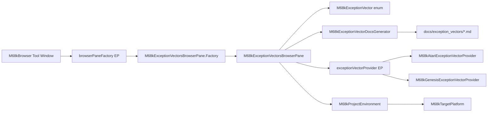

# Requirements

### Overview & Purpose

Show the M68k exception vector table (PRM Table B-1) in the IDE so developers can browse all 256 exception vectors, see their offsets, assignments, and CPU requirements. The browser adapts to the detected target platform to show platform-specific vector assignments — similar to how the Amiga hardware register browser appears only for Amiga projects.

### User Stories

- As an M68k developer, I want to browse all exception vectors in a dedicated tool window tab so I can look up vector numbers and offsets without leaving the IDE.
- As an M68k developer, I want to see which CPU supports each vector (e.g., FPU vectors require 68881/040+, MMU vectors require 68851/030+) so I know which vectors are available for my target.
- As an M68k developer, I want to see platform-specific vector assignments (e.g., Atari ST TRAP #1 is GEMDOS, SEGA Genesis IRQ 4 is horizontal retrace) so I understand which vectors my platform uses.
- As an M68k developer, I want to see the PRM reference documentation for each vector so I understand its behavior.

### Functional Requirements

- Add a new tab "Exception Vectors" to the existing M68k Browser tool window (right panel).
- Display all 256 exception vectors (0–255) in a searchable list.
- Each list item shows the vector number and assignment name (e.g., "0 — Reset Initial ISP").
- The detail pane shows: vector number, hex offset, assignment name, applicable CPUs, platform-specific notes, and PRM reference documentation.
- Filter vectors by CPU group (e.g., show only 68000-compatible vectors, or include 68010+, 68020+, FPU, MMU vectors).
- Show platform-specific annotations when a target platform is detected (e.g., Atari ST, SEGA Genesis).
- Support the existing browser pane features: speed search, history navigation, and documentation links.

### Scope

**In Scope:**
- New `M68kExceptionVector` enum with all 256 vectors from PRM Table B-1.
- New `M68kExceptionVectorsBrowserPane` extending `M68kBrowserPaneBase`.
- Extension point `exceptionVectorProvider` for platform modules to contribute platform-specific vector information.
- Registration in `plugin.xml` as a new `browserPaneFactory`.
- Bundle messages for the tab display name.
- Reference documentation (markdown) for key vectors stored in `plugin-resources/docs/`.
- Platform-specific data for Atari ST (TOS TRAP assignments, MFP interrupts) and SEGA Genesis (IRQ assignments).

**Out of Scope:**
- Runtime vector table inspection from assembled binaries.
- Navigation from code to vector handlers (e.g., `MOVE #handler, $0000` → vector 0).
- Exception stack frame visualization.


# Technical Design

### Current Implementation

The plugin uses a browser pane architecture for reference data:

- **`M68kBrowserToolWindowFactory`** creates the "M68k Browser" tool window and loads panes from the `browserPaneFactory` extension point.
- **`M68kBrowserPaneBase<T>`** (in `api/plugin-api/`) provides a split-pane UI: a searchable list on the left, a `DocumentationComponent` on the right. Subclasses implement `initList()`, `getListItemNamer()`, `getDocFor()`, and `getListCellRenderer()`.
- **`M68kBrowserPaneFactory<T, V>`** is the extension point interface. Each pane provides a nested `Factory` class.
- **`plugin.xml`** registers panes via `<browserPaneFactory>` elements (e.g., `M68kRegistersBrowserPane$Factory`).
- **`M68kRegister`** enum stores register data (token type, text, CPU set) and is browsed by `M68kRegistersBrowserPane`.
- **`M68kAmigaHardwareRegister`** enum (in `platforms/amiga/`) stores hardware register data (name, address, description, chipset, chip) and is browsed by `M68kAmigaHardwareBrowserPane`.

### Key Decisions

1. **Enum-based data model** — Follow the pattern of `M68kRegister` and `M68kAmigaHardwareRegister`. Create `M68kExceptionVector` enum with: vector number, hex offset, assignment name, and applicable CPU set.
2. **Place in main module** — Exception vectors are core M68k architecture, not platform-specific. The enum and browser pane belong in `src/`, not in a platform module.
3. **CPU filtering toolbar** — Like `M68kRegistersBrowserPane`, add a toggle to show/hide CPU-specific vectors (FPU, MMU, 68010+, 68020+).
4. **Documentation from PRM** — Generate markdown docs per vector (or per group) in `plugin-resources/docs/exception_vectors/`, following the existing pattern in `plugin-resources/docs/registers/`.
5. **Extension point for platform-specific data** — Research confirms that platforms assign specific meanings to standard vectors:
   - **Atari ST**: TRAP #1→GEMDOS, TRAP #2→GEM, TRAP #13→BIOS, TRAP #14→XBIOS, MFP interrupts at vectors 64–79.
   - **SEGA Genesis/Mega Drive**: IRQ level 4→horizontal retrace, IRQ level 6→vertical retrace.
   - **Embedded 68000**: Vectors 64–255 are application-defined, no standard assignments.
   An `exceptionVectorProvider` extension point allows platform modules to contribute additional information for specific vectors. The browser pane queries this extension point using the current `M68kTargetPlatform` from `M68kProjectEnvironment`.
6. **Platform modules pattern** — Follow the existing `platforms/amiga/` module pattern. Platform-specific vector data will live in dedicated platform modules (e.g., `platforms/atari/`, `platforms/sega-genesis/`). The Amiga hardware browser pane uses `isAvailable()` in its `Factory` to check `M68kTargetPlatform`, but the exception vectors browser is always available — it simply shows platform-specific annotations when applicable.
7. **M68kTargetPlatform enum** — The `M68kTargetPlatform` enum (in `api/plugin-api/`) currently holds `GENERIC` and `AMIGA`. New values `ATARI_ST` and `SEGA_GENESIS` must be added so that the exception vector browser, platform detectors, and the `exceptionVectorProvider` extension point can identify the active platform. The browser pane reads `M68kProjectEnvironment.getTargetPlatform()` to select the matching provider. When the platform changes, the browser refreshes its list and detail panes via `M68kProjectEnvironmentListener.targetPlatformChanged()`.

### Proposed Changes

**New files in the main module (`src/`):**

1. `src/com/yanncebron/m68kplugin/lang/psi/M68kExceptionVector.java` — Enum with 256 entries. Each entry stores: vector number (int), offset (String, hex), assignment name (String), and applicable CPUs (`Set<M68kCpu>`).

2. `src/com/yanncebron/m68kplugin/browser/M68kExceptionVectorsBrowserPane.java` — Extends `M68kBrowserPaneBase<M68kExceptionVector>`. Implements list population, rendering, and documentation lookup. Queries the `exceptionVectorProvider` extension point for platform-specific annotations.

3. `src/com/yanncebron/m68kplugin/documentation/M68kExceptionVectorDocsGenerator.java` — Generates HTML documentation for a selected vector, following the pattern of `M68kRegisterDocsGenerator`. Includes platform-specific notes when available.

4. `api/plugin-api/src/main/java/com/yanncebron/m68kplugin/browser/M68kExceptionVectorProvider.java` — Extension point interface. Platform modules implement this interface to provide additional information for specific vectors. The interface declares `getPlatform()` (returns `M68kTargetPlatform`) and `getPlatformNote(M68kExceptionVector)` (returns a platform-specific description or `null`).

5. `plugin-resources/docs/exception_vectors/` — Markdown reference docs per vector (or grouped by category: reset, exceptions, interrupts, TRAP, FPU, MMU, user-defined).

**New files in platform modules:**

6. `platforms/atari/src/main/java/com/yanncebron/m68kplugin/atari/M68kAtariExceptionVectorProvider.java` — Implements `M68kExceptionVectorProvider` for Atari ST. Provides notes for TRAP #1 (GEMDOS), TRAP #2 (GEM), TRAP #13 (BIOS), TRAP #14 (XBIOS), and MFP interrupt vectors 64–79.

7. `platforms/atari/src/main/java/com/yanncebron/m68kplugin/atari/M68kAtariTargetPlatformDetector.java` — Detects Atari ST projects by looking for TOS, GEMDOS, XBIOS, and related keywords in project files. Follows the `M68kAmigaTargetPlatformDetector` pattern.

8. `platforms/sega-genesis/src/main/java/com/yanncebron/m68kplugin/sega/genesis/M68kGenesisExceptionVectorProvider.java` — Implements `M68kExceptionVectorProvider` for SEGA Genesis. Provides notes for IRQ level 4 (horizontal retrace) and IRQ level 6 (vertical retrace).

9. `platforms/sega-genesis/src/main/java/com/yanncebron/m68kplugin/sega/genesis/M68kGenesisTargetPlatformDetector.java` — Detects SEGA Genesis projects by looking for VDP, Genesis, and Mega Drive keywords in project files.

**Modified files:**

10. `plugin-resources/META-INF/plugin.xml` — Add `<browserPaneFactory>` registration for the new pane and declare the `exceptionVectorProvider` extension point.

11. `plugin-resources/messages/M68kBundle.properties` — Add `toolwindow.tab.exception.vectors` and related messages.

12. `api/plugin-api/src/main/resources/META-INF/plugin-api.xml` — Declare the `exceptionVectorProvider` extension point.

13. `platforms/atari/src/main/resources/META-INF/m68kplugin-atari.xml` — Register the Atari ST provider and detector.

14. `platforms/sega-genesis/src/main/resources/META-INF/m68kplugin-sega-genesis.xml` — Register the SEGA Genesis provider and detector.

### Data Model

```java
enum M68kExceptionVector {
  RESET_ISP(0, "000", "Reset Initial Interrupt Stack Pointer", M68kCpu.GROUP_68000_UP),
  RESET_PC(1, "004", "Reset Initial Program Counter", M68kCpu.GROUP_68000_UP),
  ACCESS_FAULT(2, "008", "Access Fault", M68kCpu.GROUP_68000_UP),
  ADDRESS_ERROR(3, "00C", "Address Error", M68kCpu.GROUP_68000_UP),
  ILLEGAL_INSTRUCTION(4, "010", "Illegal Instruction", M68kCpu.GROUP_68000_UP),
  INTEGER_DIVIDE_BY_ZERO(5, "014", "Integer Divide by Zero", M68kCpu.GROUP_68000_UP),
  CHK(6, "018", "CHK, CHK2 Instruction", M68kCpu.GROUP_68000_UP),
  FTRAP_TRAPcc_TRAPV(7, "01C", "FTRAPcc, TRAPcc, TRAPV Instructions", M68kCpu.GROUP_68000_UP),
  PRIVILEGE_VIOLATION(8, "020", "Privilege Violation", M68kCpu.GROUP_68000_UP),
  TRACE(9, "024", "Trace", M68kCpu.GROUP_68000_UP),
  LINE_1010(10, "028", "Line 1010 Emulator", M68kCpu.GROUP_68000_UP),
  LINE_1111(11, "02C", "Line 1111 Emulator", M68kCpu.GROUP_68000_UP),
  UNASSIGNED_12(12, "030", "(Unassigned, Reserved)", M68kCpu.GROUP_68000_UP),
  COPROCESSOR_PROTOCOL(13, "034", "Coprocessor Protocol Violation", M68kCpu.GROUP_68020_UP),
  FORMAT_ERROR(14, "038", "Format Error", M68kCpu.GROUP_FLOAT),
  UNINITIALIZED_INTERRUPT(15, "03C", "Uninitialized Interrupt", M68kCpu.GROUP_68000_UP),
  // 16-23: Unassigned, Reserved
  SPURIOUS_INTERRUPT(24, "060", "Spurious Interrupt", M68kCpu.GROUP_68000_UP),
  LEVEL_1_INTERRUPT(25, "064", "Level 1 Interrupt Autovector", M68kCpu.GROUP_68000_UP),
  // ... levels 2-7
  // 32-47: TRAP #0-#15
  // 48-55: FPU exceptions (GROUP_FLOAT)
  // 56-58: MMU exceptions (GROUP_MMU)
  // 59-63: Unassigned, Reserved
  // 64-255: User Defined
  ;
  
  private final int number;
  private final String offset;
  private final String assignment;
  private final Set<M68kCpu> cpus;
}
```

### Architecture Diagram



### File Structure

```
src/
  com/yanncebron/m68kplugin/
    lang/psi/
      M68kExceptionVector.java          [NEW]
    browser/
      M68kExceptionVectorsBrowserPane.java  [NEW]
    documentation/
      M68kExceptionVectorDocsGenerator.java  [NEW]

api/plugin-api/src/main/java/com/yanncebron/m68kplugin/browser/
  M68kExceptionVectorProvider.java      [NEW — extension point interface]
api/plugin-api/src/main/java/com/yanncebron/m68kplugin/settings/ide/
  M68kTargetPlatform.java               [MODIFIED — add ATARI_ST and SEGA_GENESIS values]

plugin-resources/
  META-INF/
    plugin.xml                          [MODIFIED — add browserPaneFactory and extension point]
  messages/
    M68kBundle.properties               [MODIFIED — add tab name]
  docs/
    exception_vectors/                  [NEW directory]
      reset.md
      exceptions.md
      interrupts.md
      trap.md
      fpu.md
      mmu.md
      user_defined.md

platforms/atari/ (new module)
  src/main/java/com/yanncebron/m68kplugin/atari/
    M68kAtariExceptionVectorProvider.java  [NEW — Atari ST vector notes]
    M68kAtariTargetPlatformDetector.java  [NEW — detects Atari ST projects]
  src/main/resources/META-INF/
    m68kplugin-atari.xml  [NEW — registers provider and detector]

platforms/sega-genesis/ (new module)
  src/main/java/com/yanncebron/m68kplugin/sega/genesis/
    M68kGenesisExceptionVectorProvider.java  [NEW — Genesis vector notes]
    M68kGenesisTargetPlatformDetector.java  [NEW — detects SEGA Genesis projects]
  src/main/resources/META-INF/
    m68kplugin-sega-genesis.xml  [NEW — registers provider and detector]
```

### Platform-Specific Vector Assignments

**Atari ST (TOS):**

| Vector | Standard Name | Atari ST Assignment |
|--------|--------------|---------------------|
| 10 | Line 1010 Emulator | Line-A routines ($EB9A) |
| 26 | Level 2 Interrupt | MFP interrupt ($543C) |
| 28 | Level 4 Interrupt | MFP interrupt ($5452) |
| 33 | TRAP #1 | GEMDOS ($965E) |
| 34 | TRAP #2 | GEM ($2A338) |
| 45 | TRAP #13 | BIOS ($556C) |
| 46 | TRAP #14 | XBIOS ($5566) |
| 64–79 | User Defined | MFP interrupt vectors |

**SEGA Genesis/Mega Drive:**

| Vector | Standard Name | Genesis Assignment |
|--------|--------------|-------------------|
| 28 | Level 4 Interrupt | Horizontal retrace interrupt |
| 30 | Level 6 Interrupt | Vertical retrace interrupt |

**Embedded 68000:**

No standard assignments. Vectors 64–255 are application-defined.


# Delivery Steps

### Step 1: Create M68kExceptionVector enum and extension point
Add the core data model and the extension point for platform-specific data.
- Create `src/com/yanncebron/m68kplugin/lang/psi/M68kExceptionVector.java` with all 256 vectors from PRM Table B-1.
- Each entry stores: vector number (int), hex offset (String), assignment name (String), and applicable CPUs (`Set<M68kCpu>`).
- Vectors 0–15: core exceptions (GROUP_68000_UP).
- Vector 13: coprocessor protocol (GROUP_68020_UP).
- Vectors 14, 48–55: FPU exceptions (GROUP_FLOAT).
- Vectors 56–58: MMU exceptions (GROUP_MMU).
- Vectors 16–23, 59–63: unassigned/reserved.
- Vectors 24–31: interrupt autovectors (GROUP_68000_UP).
- Vectors 32–47: TRAP #0–#15 (GROUP_68000_UP).
- Vectors 64–255: user-defined (GROUP_68000_UP).
- Add helper methods: `findByNumber(int)`, `findByOffset(String)`.
- Add `ATARI_ST` and `SEGA_GENESIS` values to `M68kTargetPlatform` enum in `api/plugin-api/`. The enum currently holds only `GENERIC` and `AMIGA`. The new values are required by the `exceptionVectorProvider` interface and platform detectors.
- Create `api/plugin-api/src/main/java/com/yanncebron/m68kplugin/browser/M68kExceptionVectorProvider.java` extension point interface.
- The interface declares `getPlatform()` (returns `M68kTargetPlatform`) and `getPlatformNote(M68kExceptionVector)` (returns a platform-specific description or `null`).
- Declare the `exceptionVectorProvider` extension point in `api/plugin-api/src/main/resources/META-INF/plugin-api.xml`.

### Step 2: Create Exception Vectors browser pane and documentation generator
Add the browser pane UI and documentation generator.
- Create `src/com/yanncebron/m68kplugin/browser/M68kExceptionVectorsBrowserPane.java` extending `M68kBrowserPaneBase<M68kExceptionVector>`.
- Implement `initList()` to populate all 256 vectors, sorted by number.
- Implement `getListCellRenderer()` to show vector number and assignment name, with platform-specific annotations from `M68kExceptionVectorProvider`.
- Add a toolbar toggle to filter by CPU (show/hide FPU, MMU, and CPU-specific vectors), following `M68kRegistersBrowserPane`.
- Create `src/com/yanncebron/m68kplugin/documentation/M68kExceptionVectorDocsGenerator.java` following `M68kRegisterDocsGenerator`.
- The docs generator queries `M68kExceptionVectorProvider` for platform-specific notes and includes them in the detail pane.
- Generate markdown reference docs in `plugin-resources/docs/exception_vectors/` (grouped by category: reset, exceptions, interrupts, TRAP, FPU, MMU, user-defined).
- Register the pane in `plugin.xml` and add messages to `M68kBundle.properties`.

### Step 3: Create Atari ST platform module
Create the `platforms/atari/` module with platform-specific vector providers and detector.
- Create the `platforms/atari/` Gradle module following the `platforms/amiga/` pattern.
- Create `M68kAtariTargetPlatformDetector` that detects Atari ST projects by looking for TOS, GEMDOS, XBIOS, and related keywords in project files.
- Create `M68kAtariExceptionVectorProvider` with notes for TRAP #1 (GEMDOS), TRAP #2 (GEM), TRAP #13 (BIOS), TRAP #14 (XBIOS), and MFP interrupt vectors 64–79.
- Register the provider and detector in `platforms/atari/src/main/resources/META-INF/m68kplugin-atari.xml`.

### Step 4: Create SEGA Genesis platform module
Create the `platforms/sega-genesis/` module with platform-specific vector providers and detector.
- Create the `platforms/sega-genesis/` Gradle module following the `platforms/amiga/` pattern.
- Create `M68kGenesisTargetPlatformDetector` that detects SEGA Genesis projects by looking for VDP, Genesis, and Mega Drive keywords in project files.
- Create `M68kGenesisExceptionVectorProvider` with notes for IRQ level 4 (horizontal retrace) and IRQ level 6 (vertical retrace).
- Register the provider and detector in `platforms/sega-genesis/src/main/resources/META-INF/m68kplugin-sega-genesis.xml`.